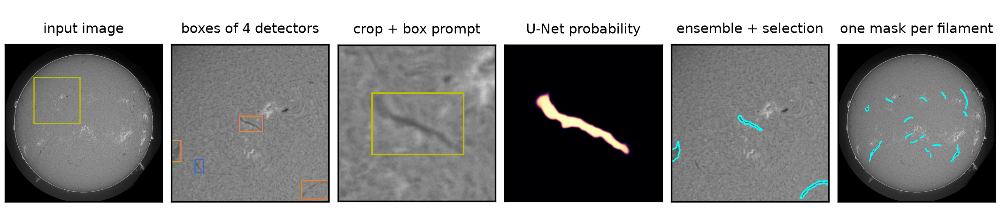

# Solar filament segmentation: detect, prompt, select

Solution to the Solar Filament Segmentation Challenge 2026 (Kaggle, MAGFiLO / GONG H-alpha images): one pixel mask per
filament, scored by Panoptic Quality against every annotator record.

| | |
|---|---|
| Validation (fold 0, 156 images no model saw) | PQ 0.462 (95% interval 0.441 to 0.483) |
| Public leaderboard | 0.40 |



1. **Detector.** Four YOLO26s detectors, each fine-tuned on three of four month-grouped folds, using 1024 px tiles at
   native resolution, one sample per (annotator record, tile). At inference each detector sees the full image at 2048 and
   1280 px with four flips; the eight box sets are fused by weighted box fusion.
2. **Mask model.** A U-Net with a ResNet18 encoder gets a padded square crop around each box plus a binary box prompt
   and outputs that filament's mask. It is trained on crops prompted with the detectors' out-of-fold boxes, one annotator
   record per image per epoch. At inference: four flips, threshold 0.40, largest connected piece.
3. **Instances.** Candidates of the four detectors that overlap (mask IoU > 0.5) become one object scored by the mean
   detector confidence. Objects are taken greedily without overlapping pixels, fragments closer than 8 px are merged,
   and the cutoff gives 6.2 instances per image.

The 4-page report is report/report.pdf; notebooks/pipeline.ipynb shows every step on real images.

## Setup

Python 3.12 and an NVIDIA GPU (developed on one RTX 4070, 12 GB).

```bash
python -m venv .venv && source .venv/bin/activate
pip install -r requirements.txt
```

Put the Kaggle data in `data/` (or point `FILAMENT_DATA` at it):

```
data/train/train_images/*.jpeg
data/train/MAGFiLO_1.0_Annotations_kaggle2026_train.json
data/test/test_images/*.jpeg
```

Everything the pipeline writes goes to `work/` (or `FILAMENT_WORK`).

## Reproduce the submission

From scratch, about three hours on one RTX 4070 (the validation step inside takes 30 minutes of it):

```bash
./reproduce.sh          # -> work/submission.csv, and the fold-0 validation score on the way
```

From the trained weights in `weights/` (the ones behind the submitted file), about 20 minutes:

```bash
mkdir -p work/weights && cp weights/*.pt work/weights/
for k in 0 1 2 3; do python run.py propose --fold $k --split test; python run.py segment --name final --split test --fold $k; done
python run.py submit --name final                                   # work/submission.csv
python run.py propose --fold 0 --split heldout                      # the fold-0 validation score
python run.py segment --name validation --split heldout --fold 0
python run.py evaluate --name validation
```

With these weights the commands reproduce the submitted file byte for byte on the same software versions, and they
produce everything notebooks/pipeline.ipynb reads.

## Code

| File | Lines | Contents |
|---|---|---|
| filaments/data.py | 79 | paths, images, annotator records, folds, RLE helpers |
| filaments/detector.py | 207 | training tiles, YOLO training, eight-view inference, weighted box fusion |
| filaments/segmenter.py | 310 | crop geometry, training crops from detector boxes, U-Net training, flip-averaged inference, candidate masks |
| filaments/instances.py | 125 | detector ensemble, pixel-disjoint selection, density cutoff, submission CSV |
| filaments/metric.py | 29 | Panoptic Quality with the organisers' per-record matching |
| run.py | 73 | command line for every step |
| reproduce.sh | 17 | the steps in order |
| folds.json | | image -> fold (whole calendar months per fold) |
| weights/ | | the four detectors and the two mask models (`final`, `validation`) |

## Validation

All numbers use fold 0 only: detector 0 never trained on it, and the validation mask model is trained without it. PQ is
computed as in the organisers' notebook: every annotator record is a separate ground truth, counts are pooled over
records.

| Fold 0 at 6.2 instances per image | |
|---|---|
| PQ (95% bootstrap interval over images) | 0.462 (0.441 to 0.483) |
| SQ / RQ | 0.692 / 0.667 |
| TP / FP / FN | 1,125 / 470 / 652 |
| PQ on images with 1 / 2 / 3 records (97 / 26 / 33 images) | 0.461 / 0.469 / 0.459 |

Training noise matters at this scale: three mask models trained with this recipe in separate runs
scored 0.462 (the run above), 0.466 and 0.468 on the same validation boxes.

The submission density (6.2 instances per image) is the best one on validation; public-board probes during development
agreed (4.9 per image: 0.39, 6.4: 0.39, 8.3: 0.38).
